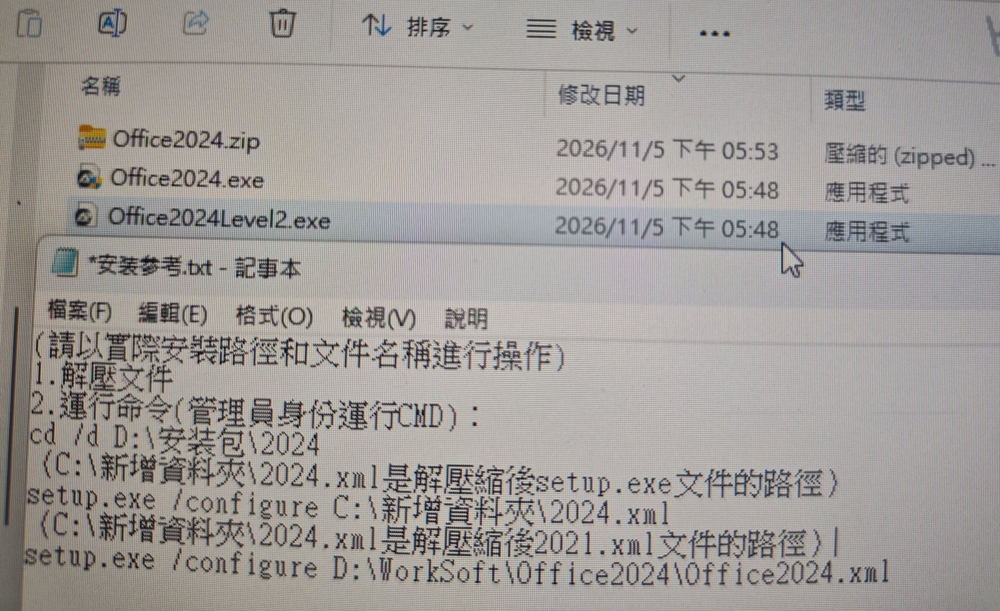
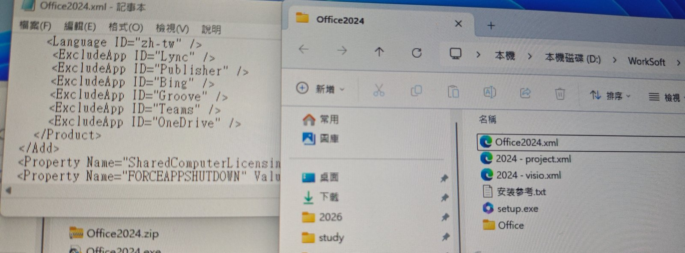
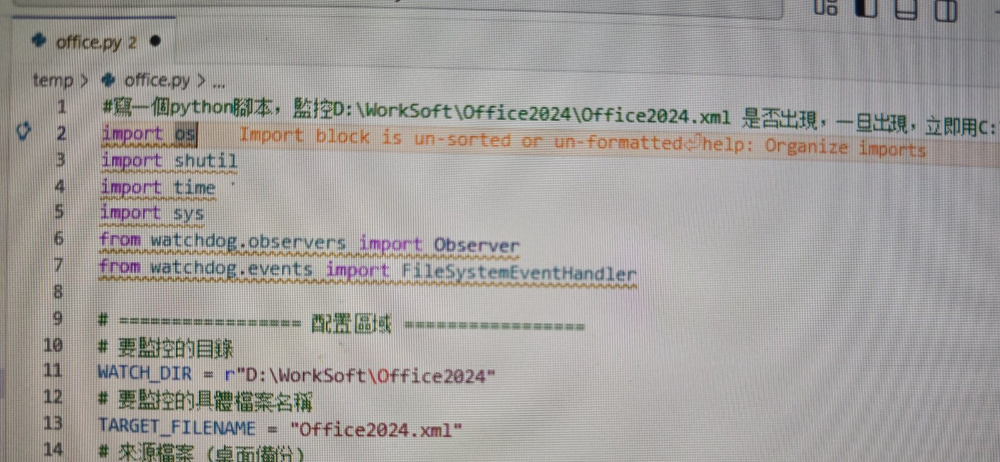

## 背景：没有管理员权限，Office 只能走内网软件商城

公司电脑不给本地管理员权限，Office 不能自己下载安装，只能通过公司内网的「软件商城」安装。

商城的安装逻辑是固定的：下载到 D 盘一个安装器 + 一个压缩包，然后按预设配置**自动静默安装**，全程不需要人点下一步。

下载到 `D:\WorkSoft\` 的安装包是这样的：



- `Office2024.exe` / `Office2024Level2.exe`：安装器
- `Office2024.zip`：Office 安装包压缩包
- 安装器把 zip 解压到 `D:\WorkSoft\Office2024\`

问题就在这里：**预设的默认配置只有 Word、Excel、PowerPoint 三件套，没有 OneNote。**

先去问了 IT 客服：公司确实有 OneNote 的授权，也明确允许安装，只是商城的默认模板里没勾这个组件。所以这不是「没有权限装」，而是「默认配置没装」——值得试一下。

## 关键发现：配置文件就在解压目录里，看到时安装已经开始

解压后的目录长这样：



`D:\WorkSoft\Office2024\` 里有：

- `setup.exe`：Office 安装程序
- `Office2024.xml`：部署配置（左侧记事本打开的就是它）
- `2024 - project.xml` / `2024 - visio.xml`：另外两个组件（Project / Visio）的配置
- `安裝參考.txt`：手工安装说明
- `Office\`：安装源文件

`setup.exe` 静默安装时读的就是同目录下的 `Office2024.xml`。而默认这份配置里没有把 OneNote 装上的部分，所以只有三件套。

安装包里的 `安裝參考.txt` 也写明了手工安装方式：

```text
1. 解壓文件
2. 運行命令（管理員身份運行CMD）：
setup.exe /configure D:\WorkSoft\Office2024\Office2024.xml
```

也就是 `setup.exe /configure <xml>`。问题是：**等你看到这份配置文件、想动手改的时候，安装器已经在跑了**——配置早就被读进去，手工改没用。

## 思路：盯住这个目录，配置文件一出现就替换

既然 XML 是「解压后生成 → 安装前读取」的中间产物，中间就存在一个时间窗：**文件已生成、setup.exe 还没读**。

这里有个坑得先排掉：商城的逻辑是**每次安装前都先把以前的安装包清理掉，再重新下载**。也就是说目录每次都是重建的，`Office2024.xml` 也是每次新生成的——你提前在里面放一份改好的配置，下一次安装照样被冲掉。静态地「留一个改好的文件在原处」没有用。

所以只能做动态替换：写一个后台脚本盯着 `D:\WorkSoft\Office2024\`，`Office2024.xml` 一出现，立刻用自己准备好的（含 OneNote 的）配置覆盖它，安装器读到的就是新配置。

## 脚本：Python + watchdog



用 `watchdog` 监听目录，检测到目标文件创建/修改就替换：

```python
# -*- coding: utf-8 -*-
import os
import shutil
import time

from watchdog.observers import Observer
from watchdog.events import FileSystemEventHandler

WATCH_DIR = r"D:\WorkSoft\Office2024"        # 要監控的目錄
TARGET_FILENAME = "Office2024.xml"           # 要監控的具體檔案名稱
SOURCE = r"C:\Users\ligua\Desktop\Office2024.xml"   # 來源檔案（桌面備份，含 OneNote）

class ReplaceHandler(FileSystemEventHandler):
    def _replace(self, path):
        if os.path.basename(path).lower() != TARGET_FILENAME.lower():
            return
        time.sleep(0.3)          # 等写入完成，避免抢读
        for i in range(3):       # 文件可能被占用，重试几次
            try:
                shutil.copy2(SOURCE, path)
                print(f"已替換: {path}")
                return
            except PermissionError:
                time.sleep(0.5)
        print(f"替換失敗: {path}")

    def on_created(self, event):
        if not event.is_directory:
            self._replace(event.src_path)

    def on_modified(self, event):
        if not event.is_directory:
            self._replace(event.src_path)

if __name__ == "__main__":
    handler = ReplaceHandler()
    observer = Observer()
    observer.schedule(handler, WATCH_DIR, recursive=False)
    observer.start()
    print(f"監控中: {WATCH_DIR}，等待 {TARGET_FILENAME} ...")
    try:
        while True:
            time.sleep(1)
    except KeyboardInterrupt:
        observer.stop()
    observer.join()
```

依赖只有一个：`python -m pip install watchdog`。

## 替换用的配置

替换后的 `Office2024.xml` 关键片段：

```xml
<Product ID="...">
  <Language ID="zh-tw" />
  <ExcludeApp ID="Lync" />
  <ExcludeApp ID="Publisher" />
  <ExcludeApp ID="Bing" />
  <ExcludeApp ID="Groove" />
  <ExcludeApp ID="Teams" />
  <ExcludeApp ID="OneDrive" />
</Product>
<Property Name="SharedComputerLicensing" Value="..." />
<Property Name="FORCEAPPSHUTDOWN" Value="..." />
```

要点：`ExcludeApp` 里排除了 Lync、Publisher、Bing、Groove、Teams、OneDrive，**唯独没有 OneNote**——这样静默安装就会把 OneNote 一起装上。

改的时候注意：`Language ID`（这台是 `zh-tw` 繁体环境）和产品 ID 必须和商城原配置保持一致，只动组件取舍，否则 setup.exe 可能直接拒绝安装。

## 操作顺序

1. 改好含 OneNote 的配置，**放在目录外**作为源文件（这里是桌面备份——安装目录每次会被清空重建，放里面也会没）；
2. 先启动 `office.py`，确认进入「監控中」状态；
3. 再打开软件商城点安装（商城会先清掉旧包，再重新下载）；
4. 安装器解压、生成配置的瞬间，脚本完成替换，setup.exe 按新配置执行；
5. 安装结束后，开始菜单出现 OneNote。

## 结果

替换成功后，OneNote 跟着 Office 一起装上了，和 Word/Excel/PPT 是同一个安装器、同一批次部署，不会出现版本错配。

## 几点注意

- **时机是唯一的难点**：必须先把监控跑起来再点安装；替换要发生在 setup.exe 读取配置之前，人工盯着改来不及；
- **每次安装都要跑脚本**：商城安装前会清掉旧包重新下载，配置每次重新生成，改一次文件不会留存；
- **配置字段要对齐**：产品 ID、Language（`zh-tw`）、位数、Channel 必须和商城原配置一致，只改组件取舍；
- **备份原配置**：替换前留一份原文件，装失败可以回滚；
- **文件占用**：setup.exe 以管理员身份运行时可能锁住配置，脚本里对 `PermissionError` 重试几次更稳；
- **路径可能要修**：如果商城换版本、解压目录变了，`WATCH_DIR` 和 `TARGET_FILENAME` 跟着改。
